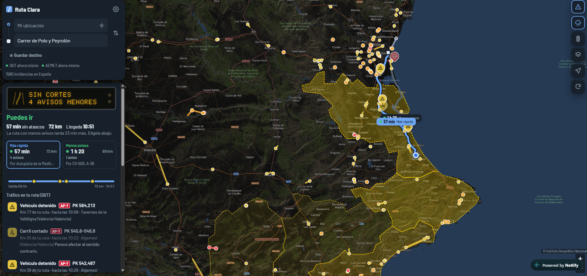

# Ruta Clara

Pones a dónde vas y te dice si puedes ir: traza la ruta en coche desde tu ubicación, cruza el recorrido con las incidencias oficiales de la DGT (cortes, accidentes, retenciones, obras, cadenas) y con los avisos meteorológicos de AEMET, y te da un veredicto tipo semáforo con la lista de problemas por kilómetro de tu ruta.

## Qué hace

- **Cartografía oficial del IGN**: Mapa base IGN (normal o gris), Ortofoto PNOA con carreteras y nombres, y Topográfico MTN. OpenStreetMap como respaldo. Se elige con el botón de capas.
- Buscador de direcciones.
- **Dos rutas: la más rápida y la de menos avisos.** Si la rápida pasa por un corte o accidente, calcula otra que lo evite (Valhalla, servidor público de OpenStreetMap) y te enseña cuánto tarda de más.
- **Pensada para el móvil**: buscador que se recoge, panel inferior que se arrastra (recogido, medio o completo) y capas en un solo botón.
- **Incidencias DGT en el mapa** y, sobre tu ruta, en qué kilómetro están y a qué hora llegarías a ellas.
- **Avisos AEMET** (amarillo, naranja, rojo) dibujados como zonas, y si te pillan durante el viaje.
- **Previsión en ruta** (Open-Meteo): lluvia fuerte, nieve, rachas o niebla a la hora a la que pasarás por cada tramo.
- **Tráfico en directo** opcional con una clave gratuita de TomTom (Ajustes).
- Botón para **abrir la ruta en Google Maps** y navegar.
- Destinos guardados (Casa, Trabajo…) y mantener pulsado en el mapa para elegir un destino.

## Tráfico en directo (opcional)

1. Crea una cuenta gratuita en developer.tomtom.com y copia tu API key.
2. En la app: **Ajustes → Clave de TomTom**. Se activa la capa con las carreteras coloreadas por velocidad real.

## Límites que conviene saber

- La DGT publica incidencias de toda España **excepto Cataluña y País Vasco**, que tienen sus propios servicios.
- La duración de la ruta es la habitual sin atascos; los atascos se ven por las retenciones de la DGT o con la capa de TomTom.
- Si una incidencia indica sentido creciente o decreciente y parece afectar al contrario al tuyo, se muestra atenuada y no pone el semáforo en rojo.
- Mapas: servicios WMTS del IGN/CNIG (uso libre citando al IGN). Rutas con OSRM y búsqueda con Photon/Nominatim: servicios públicos y gratuitos basados en OpenStreetMap, pensados para uso personal.

## Archivos

| Archivo | Para qué |
|---|---|
| `index.html` | La app completa |
| `_redirects`, `netlify.toml` | Reglas de Netlify para traer los datos de la DGT y AEMET |
| `scripts/actualizar_datos.py` | Descarga y convierte DGT + AEMET |
| `manifest.webmanifest`, `icon*.png`, `icon.svg` | Para instalarla como app |
| `docs/captura.png` | Captura que se ve en este README |
